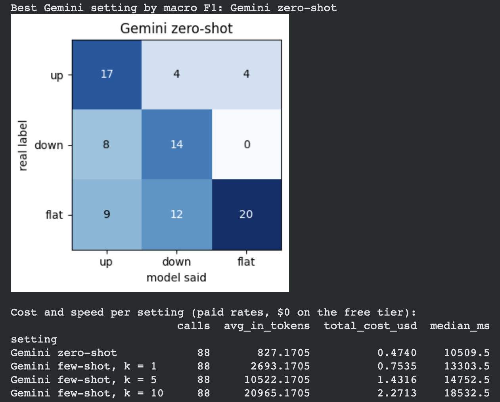
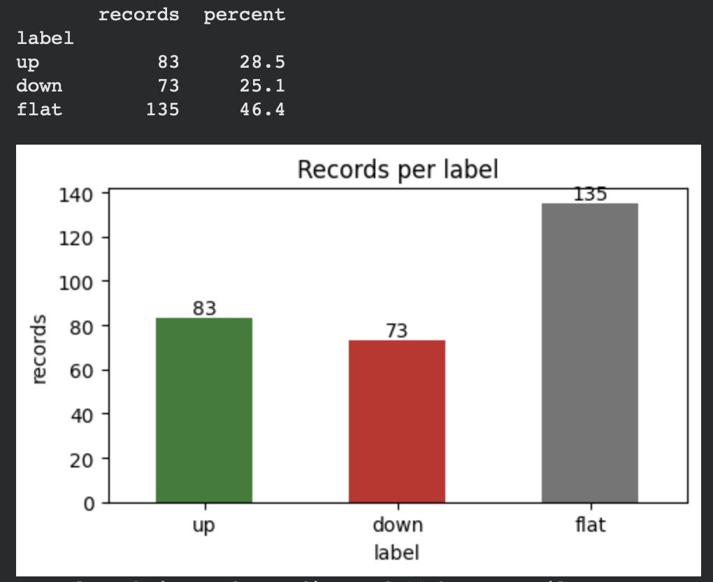
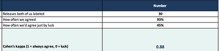
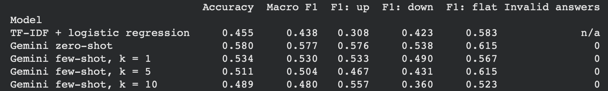

# Can an AI read an earnings press release?

**An LLM labeling and evaluation project. INFO 367, Applied Large Language Models for Business, Montclair State University, Fall 2026.**

I led a team of four on this project. We built a labeled dataset from scratch, wrote a labeling guide and measured how well two people agree on it, then tested five classifiers on the same 88 test records: a word-count baseline and Google's Gemini with zero, one, five and ten examples per label. The best model read each release cold and got 58% right. The interesting part is why that number is not as good as it looks.

**The question.** Can a model read the first 400 words of an S&P 500 company's earnings press release and predict whether the stock beat the S&P 500 by more than 3% (up), trailed it by more than 3% (down), or stayed within 3% (flat) by the next close?

## Results

Five models, the same 88 test releases, the submitted run of October 25, 2026.

| Model | Accuracy | Macro F1 | F1 up | F1 down | F1 flat |
|---|---|---|---|---|---|
| TF-IDF + logistic regression (baseline) | 45.5% | 0.438 | 0.308 | 0.423 | 0.583 |
| Gemini zero-shot | **58.0%** | **0.577** | 0.576 | 0.538 | 0.615 |
| Gemini few-shot, 1 example per label | 53.4% | 0.530 | 0.533 | 0.490 | 0.567 |
| Gemini few-shot, 5 per label | 51.1% | 0.504 | 0.467 | 0.431 | 0.615 |
| Gemini few-shot, 10 per label | 48.9% | 0.480 | 0.557 | 0.360 | 0.523 |

Always guessing flat would score 46.6%, so the baseline is no better than that. Zero invalid answers from Gemini: every reply was parsed as up, down or flat.

<p align="center">
  
</p>

**Cost.** 352 Gemini calls, $4.93 at paid rates, under a $5 spend ceiling and a call cap written into the notebook. Zero-shot was the cheapest setting ($0.47 for the 88 test records) and the best. Ten examples per label cost $2.27, about 21,000 input tokens per call, and did worse.

**The honest part.** I re-ran all four Gemini settings two days later. 55 of the 352 answers changed. Zero-shot fell to 48.9% and the ten-example setting rose to 52.3%. With 88 test records, the gaps between the Gemini settings are noise, and a paired test of zero-shot against the baseline does not reach significance (p = 0.13). The report says "lead", not "win". Both runs are in `results/`.

## What I did

- **Led the group.** Picked the topic with the team, wrote the plan and split the work into seven steps, kept the two-week timeline from the first meeting (Oct 14) to submission (Oct 27).
- **Designed the label.** The stock's move against the S&P 500, close to close, with a 3% cutoff and a timing rule: a release before the open is measured from the prior close to that day's close; a release after the close is measured to the next day's close; releases during market hours were dropped. The labeling guide has a clear example, a boundary case and a tie-breaking rule for each label.
- **Built the dataset, with Claude as my coding tool.** Two Python scripts pull every earnings filing (Form 8-K, Item 2.02, Exhibit 99.1) for 110 random S&P 500 companies from SEC EDGAR, pull the daily closes from Yahoo Finance, and clean 908 filings down to 300 records with every drop counted (`data/`).
- **Built and ran the notebook.** Starting from the course's Week 5 template: setup, loading and cleaning, one stratified 70/30 split used by every model, the TF-IDF + logistic regression baseline tuned by cross-validation on the training set only, one scorer for every model, and the file exports. Teammates owned the Gemini steps, the error review and the write-up of what it means. Every Gemini answer is saved the moment it arrives, so a Colab disconnect (we had one at 209 of 352) costs nothing, and the final notebook only reads the saved answers.
- **Wrote and submitted the report.** Twelve pages: labeling guide, data provenance statement, results, limitations and the AI use note.

## How the data was built

| Step | Records left | Why |
|---|---|---|
| Earnings filings found on SEC EDGAR | 908 | all Item 2.02 filings since Oct 1, 2024, for 110 companies (10 random per sector, 11 sectors, seed 367) |
| Press release found | 895 | 13 filings had no downloadable release |
| Released outside market hours | 617 | 278 released during the trading day were dropped |
| No short texts or duplicates | 616 | one release dropped at this step |
| Random sample, seed 367 | 300 | the submitted CSV: 84 up, 74 down, 142 flat; the other 316 are held for the final project |
| Not an earnings release, removed in the notebook | 291 | a spin-off, investor slides, a CFO change, a webinar notice and five others; the models use 83 up, 73 down, 135 flat |

Each record is the first 400 words of the release, converted from the SEC web page to plain text with the SEC header removed. Sentences describing the stock's own price move were removed so the text could not reveal the label (five records). None of the text is AI-generated. The 291 records come from 79 companies across all 11 sectors, October 2024 to September 2026.

<p align="center">
  
</p>

The dataset itself is not in this repository. The releases are company documents filed with the SEC, so the scripts in `data/` rebuild it from the public sources instead; they need your own name and contact address in the SEC `User-Agent` line, as the SEC asks.

## The labeling guide, and what two people agreed on

Two teammates each labeled the same 30 releases on their own, from the text alone, without seeing the price or each other's answers. They agreed on 28 of 30 (93%), Cohen's kappa 0.88. The two disagreements were talked out and each one became a new rule in the guide: mixed news goes by the main results (EPS and revenue), and a release with no results in its first 400 words is flat.

<p align="center">
  
</p>

Then the twist. Compared with the real stock move, those careful human labels were right on only 10 of 30 (33%), about the same as guessing among three labels. One homebuilder's release looked weak (EPS down, revenue down) and both labelers said down; the stock beat the S&P 500 by 3.4%. The market reacts to what it expected, and the press release does not say what that was. That 33% is now our human baseline for the final project.

## The five models

**Baseline.** TF-IDF + logistic regression, tuned by five-fold cross-validation on the 203 training records (best settings: C 0.5, min_df 3, single words). Its top "up" words make sense (grew, growth, margin, EPS); its "down" words are mostly numbers and noise, so bad news is hard to spot from word counts alone.

**Gemini** (`gemini-3.7-flash`), asked for JSON only, with the same label definitions as the labeling guide. The zero-shot prompt:

```
You read company earnings press releases and predict how the stock reacted.

Choose the ONE label that best describes how the stock moved compared to the S&P 500,
from the close right before the release to the close of the next trading day.

Labels:
- up: after this release, the stock beat the S&P 500 by more than 3% from the close before the release to the close of the next trading day
- down: after this release, the stock did worse than the S&P 500 by more than 3% over the same window
- flat: the stock finished within 3% of the S&P 500 over the same window

Press release:
{text}

Return JSON only.
```

The few-shot settings add 1, 5 or 10 solved examples per label, drawn from the training set only with a fixed seed and nested (the 5-example set contains the 1-example set, and so on). Every call is logged with tokens, cost, latency and attempts (`results/gemini_call_log.csv`). Invalid answers would count as wrong, never dropped; there were none.

<p align="center">
  
</p>

## What I learned

- **Where a label comes from matters more than the model.** A label from prices is cheap and repeatable. A label from people cost two teammates an evening and matched the market 33% of the time. Hand labels still earned their keep: they proved the guide was clear (kappa 0.88) and gave us a human baseline.
- **Report the run you saved, and say what a re-run did.** Gemini does not answer the same way twice. With 88 test records, differences of a few points between settings mean nothing, and I would rather say so than claim a win.
- **More context is not free and not always better.** Ten examples per label multiplied the input tokens by 25 and lowered the score in the submitted run.
- **Evaluation discipline is most of the work.** One split for every model, one scorer, invalid answers counted as wrong, every call logged, a spend ceiling before the first call, answers saved as they arrive.
- **Clean before you sample.** Nine of the 300 records were not earnings releases, and a teammate found them by reading. The next round removes them before the sample is drawn and records the reason for every drop.

## What's next

The final project in December scales this to 500 or more records with a fresh test set, bootstrap confidence intervals, a measured run-to-run variation, a timed human baseline, a cost model against an analyst's wage, and a 12-minute business case.

## What's in this repository

| Path | What it is |
|---|---|
| `notebook/earnings_release_notebook.ipynb` | The submitted Colab notebook, run top to bottom with every output. Teammates' names are replaced with roles in this public copy. It reads the saved Gemini answers and makes no new calls. |
| `data/pull_earnings_data.py` | Finds each company's earnings filings on SEC EDGAR and pulls the daily closes from Yahoo Finance. No API keys. |
| `data/pull_press_release_text.py` | Downloads each press release (Exhibit 99.1) and converts it to plain text. |
| `data/tickers.csv` | The 110 companies sampled, with sector. |
| `results/results_table_submitted_run.csv` | The five-model table from the submitted run (Oct 25). |
| `results/results_table_second_run.csv` | The same table from the re-run two days later (Oct 27), not submitted, kept for honesty. |
| `results/gemini_call_log.csv` | Every Gemini call: setting, model, tokens in and out, cost, latency, attempts. |
| `results/gemini_predictions.csv` | Every Gemini answer by setting and record id, with the raw JSON. |
| `figures/` | The four pictures above, taken from the notebook and the labeling sheet. |

## AI use

The course requires an AI use note on every submission, and I keep the same rule here. Claude (Anthropic) wrote and ran the two data scripts under my direction, cleaned the data, built the Excel sheets and the first version of the notebook from the course template, and helped draft the report. Gemini (Google) was the model under test. The labeling decisions, the calls on the two disagreements, the error review and every "what this shows" sentence were ours, and we checked every number against the saved files.

## Course

INFO 367, Applied Large Language Models for Business, Montclair State University, Fall 2026. Deliverable 1 of the team project, submitted October 27, 2026. Graded 95/100.

## About me

I'm Muhammad Nabeel, a Business Analytics student at Montclair State University (BBA, graduating Fall 2026). I build things that have to be measured before they are believed: this project, a deployed RAG advising chatbot, a live systematic trading system, and [Ember](https://embernotebook.com), a private AI notebook for Mac that I designed and built and that went public in October 2026.

[GitHub profile](https://github.com/MrNabeel) · [LinkedIn](https://www.linkedin.com/in/mrnabeel1) · [Ember](https://embernotebook.com)
